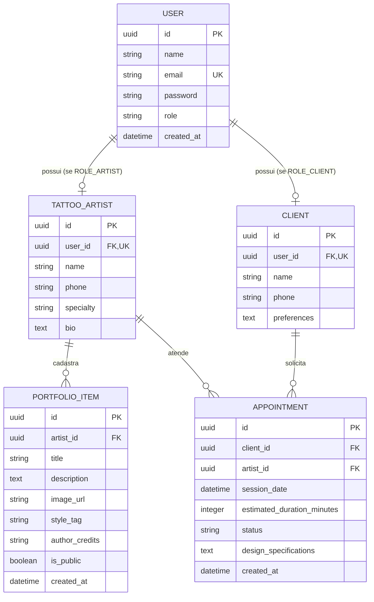

# Tattoo Studio API - Documentação Técnica do Sistema

---

## 1. Visão Geral

A **Tattoo Studio API** é uma aplicação backend desenvolvida em **Java** e **Spring Boot**, concebida para gerenciar as operações de um estúdio profissional de tatuagem. A plataforma provê recursos para cadastro de usuários (clientes e tatuadores), autenticação stateless baseada em tokens JWT com controle de acesso baseado em papéis (RBAC), gerenciamento de portfólio de obras autorais com suporte a upload de imagens multipart e URLs externas, além de um sistema completo de agendamento de sessões com validação de conflitos de agenda.

---

## 2. Arquitetura e Padrões de Projeto

A aplicação segue o padrão arquitetural em camadas do ecossistema Spring Framework, visando o isolamento de responsabilidades, alta coesão e baixo acoplamento:

```
src/main/java/com/studio/tattoo/
├── config / security/     # Segurança, filtros JWT, CORS, OpenAPI/Swagger e recursos estáticos
├── controller/           # Camada de apresentação e contratos REST (Endpoints HTTP)
├── exception/            # Tratamento centralizado de erros e exceções da aplicação
└── model/                # Núcleo de domínio (Entities, DTOs, Repositories e Services)
    ├── appointment/      # Módulo de agendamentos de sessões
    ├── artist/           # Módulo de perfil e especialidades dos tatuadores
    ├── client/           # Módulo de perfil e preferências dos clientes
    ├── portfolio/        # Módulo de acervo, obras e upload de portfólio
    └── user/             # Módulo de autenticação, credenciais e papéis (RBAC)
```

### Padrões Adotados
- **RESTful API**: Endpoints organizados por substantivos e recursos, com utilização semântica dos verbos HTTP (`GET`, `POST`, `PUT`, `PATCH`, `DELETE`) e códigos de status apropriados (`200 OK`, `201 Created`, `204 No Content`, `400 Bad Request`, `401 Unauthorized`, `403 Forbidden`, `404 Not Found`).
- **Data Transfer Object (DTO)**: Implementados via Java `record` com anotações de validação (`jakarta.validation`), separando a representação trafegada na rede do modelo de persistência.
- **Service Layer**: Centralização de regras de negócio e controle transacional via `@Transactional`.
- **Repository Pattern**: Abstração de persistência relacional através do Spring Data JPA (`JpaRepository`).
- **Stateless Authentication**: Sessões de autenticação gerenciadas via tokens JWT (JSON Web Token), sem persistência de estado em memória de servidor.
- **Global Exception Handler**: Interceptador global com `@RestControllerAdvice` padronizando as respostas de erro da API.

---

## 3. Stack Tecnológica

| Componente | Tecnologia | Versão |
| :--- | :--- | :--- |
| **Linguagem** | Java | 21 / 26 LTS |
| **Framework Base** | Spring Boot | 4.1.2 |
| **Segurança** | Spring Security | 6.x |
| **Autenticação** | JJWT (io.jsonwebtoken) | 0.12.6 |
| **Persistência** | Spring Data JPA / Hibernate | 6.x |
| **Banco de Dados** | MySQL (Produção / Dev) / H2 (Testes) | MySQL 8.x |
| **Validação** | Jakarta Bean Validation / Hibernate Validator | 3.x |
| **Documentação Interativa** | SpringDoc OpenAPI (Swagger UI) | 2.8.5 |
| **Utilitários** | Lombok | 1.18.36 |
| **Gerenciador de Dependências** | Apache Maven | 3.9+ |

---

## 4. Modelo de Dados e Entidades



### Detalhamento das Entidades

1. **User (`users`)**:
   - Representa a credencial de autenticação no sistema.
   - Campos: `id` (UUID), `name`, `email` (único), `password` (armazenado com hash BCrypt), `role` (`ROLE_CLIENT` ou `ROLE_ARTIST`), `createdAt`.
   - Implementa a interface `UserDetails` do Spring Security.

2. **TattooArtist (`tattoo_artists`)**:
   - Perfil profissional do tatuador, vinculado de forma 1:1 ao `User`.
   - Campos: `id` (UUID), `user` (relação 1:1), `name`, `phone`, `specialty` (ex.: Blackwork, Fineline, Realismo), `bio`.
   - Relacionamentos: Coleção de itens de portfólio e lista de agendamentos.

3. **Client (`clients`)**:
   - Perfil do cliente solicitante, vinculado de forma 1:1 ao `User`.
   - Campos: `id` (UUID), `user` (relação 1:1), `name`, `phone`, `preferences` (estilos favoritos, restrições ou notas pessoais).
   - Relacionamentos: Lista de agendamentos solicitados.

4. **PortfolioItem (`portfolio_items`)**:
   - Obra autoral ou fotografia de trabalho publicado pelo tatuador.
   - Campos: `id` (UUID), `artist` (relação N:1), `title`, `description`, `imageUrl`, `styleTag`, `authorCredits`, `isPublic`, `createdAt`.

5. **Appointment (`appointments`)**:
   - Sessão de tatuagem agendada entre um cliente e um tatuador.
   - Campos: `id` (UUID), `client` (N:1), `artist` (N:1), `sessionDate`, `estimatedDurationMinutes`, `status` (`PENDING`, `CONFIRMED`, `FINISHED`, `CANCELLED`), `designSpecifications`, `createdAt`.

---

## 5. Módulos e Catálogo de Endpoints

### 5.1. Módulo de Autenticação (`/auth`)

| Método | Rota | Autenticação | Descrição |
| :--- | :--- | :--- | :--- |
| `POST` | `/auth/register` | Pública | Cadastra um novo usuário (`ROLE_CLIENT` ou `ROLE_ARTIST`) e gera seu perfil correspondente |
| `POST` | `/auth/login` | Pública | Autentica via email e senha, retornando o token JWT e dados do usuário |

#### Payload de Registro (`RegisterRequestDTO`):
```json
{
  "name": "João da Silva",
  "email": "joao@email.com",
  "password": "senhaSegura123",
  "role": "ROLE_CLIENT",
  "phone": "(11) 98765-4321",
  "preferences": "Interesse em tatuagens minimalistas e aquarela"
}
```

#### Resposta de Autenticação (`TokenResponseDTO`):
```json
{
  "token": "eyJhbGciOiJIUzUxMiJ9...",
  "id": "e3b0c442-98fc-1c14-9afb-4c7c59d31023",
  "name": "João da Silva",
  "email": "joao@email.com",
  "role": "ROLE_CLIENT"
}
```

---

### 5.2. Módulo de Clientes (`/clients`)

| Método | Rota | Permissão Requerida | Descrição |
| :--- | :--- | :--- | :--- |
| `GET` | `/clients/me` | `ROLE_CLIENT` | Retorna o perfil completo do cliente autenticado |
| `PUT` | `/clients/me` | `ROLE_CLIENT` | Atualiza dados cadastrais e preferências do cliente autenticado |
| `GET` | `/clients/{id}` | Usuário autenticado | Consulta dados de um cliente pelo identificador UUID |

---

### 5.3. Módulo de Tatuadores (`/artists`)

| Método | Rota | Permissão Requerida | Descrição |
| :--- | :--- | :--- | :--- |
| `GET` | `/artists` | Pública | Lista os tatuadores cadastrados (com filtro opcional `?specialty=...`) |
| `GET` | `/artists/me` | `ROLE_ARTIST` | Retorna o perfil cadastrado do tatuador autenticado |
| `PUT` | `/artists/me` | `ROLE_ARTIST` | Atualiza o próprio perfil do tatuador autenticado |
| `GET` | `/artists/{id}` | Pública | Consulta detalhes públicos de um tatuador específico |
| `GET` | `/artists/{id}/booked-slots` | Pública | Lista os horários de sessões confirmadas/ocupadas de um tatuador |
| `PUT` | `/artists/{id}` | `ROLE_ARTIST` | Atualiza o perfil do tatuador informando ID (valida posse) |

---

### 5.4. Módulo de Portfólio (`/portfolio`)

| Método | Rota | Permissão Requerida | Descrição |
| :--- | :--- | :--- | :--- |
| `GET` | `/portfolio` | Pública | Lista itens do portfólio (com filtros `?artistId=...&styleTag=...`) |
| `GET` | `/portfolio/{id}` | Pública | Consulta detalhada de uma obra por ID |
| `POST` | `/portfolio` | `ROLE_ARTIST` | Cadastra item via upload físico de imagem (`multipart/form-data`) |
| `POST` | `/portfolio` | `ROLE_ARTIST` | Cadastra item informando URL externa (`application/json`) |
| `PUT` | `/portfolio/{id}` | `ROLE_ARTIST` | Atualiza metadados de obra pertencente ao tatuador |
| `DELETE` | `/portfolio/{id}` | `ROLE_ARTIST` | Remove uma obra do portfólio e apaga seu arquivo local |

---

### 5.5. Módulo de Agendamentos (`/appointments`)

| Método | Rota | Permissão Requerida | Descrição |
| :--- | :--- | :--- | :--- |
| `POST` | `/appointments` | `ROLE_CLIENT` | Solicita novo agendamento de sessão com um tatuador |
| `GET` | `/appointments` | Usuário autenticado | Lista agendamentos do usuário (visão do cliente ou do tatuador) |
| `GET` | `/appointments/{id}` | Participante da sessão | Consulta detalhes de um agendamento específico |
| `PUT` | `/appointments/{id}` | Participante da sessão | Reagenda data/duração ou edita especificações do desenho |
| `PATCH` | `/appointments/{id}/status` | Participante (com regras) | Transita status (`CONFIRMED`, `FINISHED`, `CANCELLED`) |
| `DELETE` | `/appointments/{id}` | Participante da sessão | Cancela o agendamento (define status como `CANCELLED`) |

---

## 6. Regras de Negócio e Políticas de Segurança

### 6.1. Regras de Agendamento de Sessões
1. **Validação Temporal**: O agendamento só é aceito para datas estritamente futuras (`@Future`).
2. **Duração Mínima**: Cada sessão deve ter duração mínima de 15 minutos (`@Min(15)`).
3. **Detecção de Conflitos de Agenda**:
   - Um novo agendamento não pode sobrepor o intervalo `[sessionDate, sessionDate + estimatedDurationMinutes]` de qualquer agendamento existente para o mesmo tatuador que não esteja no status `CANCELLED`.
4. **Ciclo de Vida e Transições de Status**:
   - `PENDING` -> Estado inicial quando criado pelo cliente.
   - `CONFIRMED` -> Pode ser acionado **exclusivamente pelo tatuador responsável**.
   - `FINISHED` -> Pode ser finalizado **exclusivamente pelo tatuador responsável**.
   - `CANCELLED` -> Pode ser acionado por ambos os participantes (cliente ou tatuador). Agendamentos cancelados ou finalizados não podem sofrer edições posteriores.

### 6.2. Políticas de Autenticação e Autorização (RBAC)
- Todas as senhas são criptografadas com **BCrypt** antes da persistência.
- O token JWT é assinado via algoritmo HMAC-SHA com chave simétrica configurável (`JWT_SECRET`) e validade expressa em horas (`JWT_EXPIRATION_HOURS`).
- O cabeçalho padrão esperado para autenticação é: `Authorization: Bearer <token>`.
- Os filtros do Spring Security interceptam cada requisição stateless, populando o `SecurityContextHolder`.

---

## 7. Configuração e Execução do Projeto

### 7.1. Pré-requisitos
- **Java Development Kit (JDK)**: versão 21 ou superior instalada e configurada na variável `JAVA_HOME`.
- **Banco de Dados Relacional**: Servidor MySQL 8.x ativo ou instância compatível.

### 7.2. Configuração do Ambiente (`.env`)

Crie ou edite o arquivo `.env` na raiz do projeto com as seguintes chaves de configuração:

```env
SERVER_PORT=8080
DATABASE_URL=jdbc:mysql://localhost:3306/tatto-studio?createDatabaseIfNotExist=true&useTimezone=true&serverTimezone=UTC
DB_USERNAME=root
DB_PASSWORD=sua_senha_aqui

JPA_SHOW_SQL=true
JPA_HIBERNATE_DDL_AUTO=update

UPLOAD_DIR=uploads

# JWT Configuration
JWT_SECRET=ChaveSuperSecretaComTamanhoMinimoDe256BitsParaAssinaturaHMACSHA256!
JWT_EXPIRATION_HOURS=2

# Limites de Multipart Upload
MULTIPART_MAX_FILE_SIZE=5MB
MULTIPART_MAX_REQUEST_SIZE=6MB
```

### 7.3. Comandos de Inicialização e Testes

#### Compilar e executar a aplicação:
```bash
./mvnw clean spring-boot:run
```

#### Executar a suíte de testes automatizados:
```bash
./mvnw test
```

#### Acessar a Documentação Interativa OpenAPI / Swagger:
Com a aplicação em execução, acesse pelo navegador:
- **Swagger UI**: `http://localhost:8080/swagger-ui/index.html`
- **OpenAPI JSON Spec**: `http://localhost:8080/v3/api-docs`
